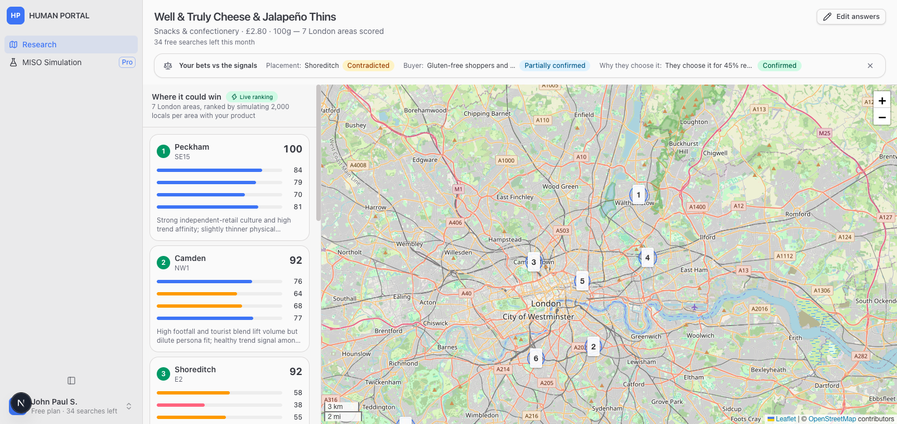

# HUMAN PORTAL

**Where should I sell this product?**

**[Try the live demo](https://human-portal-omega.vercel.app/research)** · no sign-up or setup needed

https://github.com/user-attachments/assets/e96fe085-4a37-4680-888c-c5574a7550f5

The video follows one simulated week in Camden. 158 shops stock a new snack, but only 22 of
2,000 simulated Londoners buy it. Then you ask one of them why, and the answer is placement,
not price.

HUMAN PORTAL helps a food or drink founder decide *where in London* to launch a product.
You describe the product and your assumptions, and it:

1. **Maps the opportunity.** Ranks London areas by how well the product sells to simulated
   local shoppers, and
   shows the evidence behind each area (live posts from Reddit and Stack Exchange).
2. **Checks your bets.** Flags where the evidence confirms or contradicts what you guessed
   about your buyer and your best location.
3. **Simulates real shoppers.** Runs the product past **2,000 simulated Londoners** for a week
   and shows who saw it, who wanted it, who bought it, and why the rest didn't.



---

## Quick start

You need **Node.js 20+** and **Python 3.11+**. Run the backend and frontend in two terminals.

### 1. Backend (simulation API), port 8000

```bash
cd backend
python -m venv .venv

# Windows
.venv\Scripts\activate
# macOS / Linux
source .venv/bin/activate

pip install -r requirements.txt
cp .env.example .env          # optional: add a DEEPSEEK_API_KEY (see below)
uvicorn app.main:app --port 8000
```

Check it's running: open http://localhost:8000/api/health. API docs are at http://localhost:8000/docs.

### 2. Frontend (web app), port 3000

```bash
cd frontend
npm install
npm run dev
```

Open **http://localhost:3000**.

> **No API keys needed to try it.** Without a DeepSeek key, shopper interviews use built-in
> template answers. If the backend isn't running, the app falls back to its example data,
> so every screen still works. Chatting with a Londoner is the one feature that does need a key.

### Optional settings (`backend/.env`)

| Variable | What it does |
|---|---|
| `DEEPSEEK_API_KEY` | Turns on chat with simulated Londoners, AI-written shopper interviews, the AI summary report and sentiment tagging of live posts |
| `POPULATION_SIZE` | Number of simulated shoppers (default 2000) |
| `INTERVIEW_COUNT` | How many shoppers get interviewed after a run (default 80) |

If the backend isn't on `localhost:8000`, set `NEXT_PUBLIC_API_URL` for the frontend.

---

## How to use it (demo walkthrough, about 3 minutes)

1. **Land on the map.** The home page opens on the Research map with an example product
   (*Well & Truly Cheese & Jalapeño Thins*, a £2.80 snack), so you can see results straight away.
2. **Read the ranked areas.** The left list ranks London areas by opportunity score. When the
   backend is running you'll see a **Live ranking** badge: each area is scored by running the
   simulated shoppers with your product. Click an
   area or its circle on the map to open the **evidence sidebar**, with the score breakdown and
   live posts about the category.
3. **Check "Your bets vs the signals".** The strip at the top shows which of the founder's
   guesses (best location, likely buyer, why they buy) the evidence confirms or contradicts.
4. **Test your own product.** Click **Test your product** at the top right. Answer the short
   interview, or press **Demo data** to fill it in automatically, then submit. The map then
   updates for your product.
5. **Simulate.** In an area's sidebar, click **Simulate [product] here**. The simulation shows:
   - a **funnel**: saw it → noticed it → wanted it → bought it
   - the **top reasons people didn't buy** (no shop nearby, didn't notice, too expensive,
     doesn't fit their diet, loyal to another brand)
   - **which groups converted** (age, area, lifestyle, income)
   - **interviews** with simulated shoppers, and an **action list**
6. **Watch the week and ask why.** The simulation opens with a replay of all 2,000 Londoners on
   a map. Click any dot to see that person's week, then open **Ask [name]** to chat with them.
   Chat needs a DeepSeek key.

---

## How the simulation works (short version)

- **The shoppers are built from real London data.** Age, sex, ethnicity, religion, job,
  employment and how people get to work are sampled neighbourhood by neighbourhood from the
  **UK Census 2021**. Homes are placed using ONS area data, and real shops, gyms and
  universities come from **OpenStreetMap**.
- **Their behaviour is modelled.** Personality, price sensitivity, media habits, diet and
  daily routines come from rules, not real survey data.
- **Each shopper lives a week.** At each point in their day, the engine checks whether they
  pass a shop that stocks your product, notice it, want that kind of product right then, and
  accept the price, ingredients and brand. Results are reproducible: the same inputs always
  give the same outcome.
- **The AI only writes the words.** The simulation decides what each shopper did. The language
  model then puts that into a short first-person quote and is not allowed to change the facts.

The population ships pre-built in `backend/data/processed/`, so there's nothing to download.

---

## Hosted demo (Vercel)

The hosted version runs without the Python backend. It replays real, pre-run simulations of the
example product in all 7 areas from `frontend/public/demo/`. Chatting with a Londoner goes through
a small serverless function (`frontend/src/app/api/chat/route.ts`) that calls DeepSeek. Testing
your own product needs the full local setup above. Live posts and live ranking need the local
backend, so the hosted demo shows example evidence.

**Deploy:** import the repo in Vercel, set **Root Directory** to `frontend`, and add these
environment variables:

| Variable | Value |
|---|---|
| `NEXT_PUBLIC_DEMO_MODE` | `1` (required) |
| `DEEPSEEK_API_KEY` | Your key. Leave it out to switch chat off |
| `CHAT_LIMIT_PER_HOUR` | Messages per visitor per hour (default 20) |
| `CHAT_DAILY_CAP` | Messages per day across the site (default 500) |
| `CHAT_DISABLED` | `1` turns chat off without removing the key |

The chat limits are best-effort and kept per server instance, so your DeepSeek balance is the
hard spending limit.

**Refreshing the demo data** after changing the engine: with the backend set up, run
`python -m app.pipeline.export_demo` from `backend/`. It reuses cached runs, so only new runs
call DeepSeek.

---

## Project layout

```
frontend/   Next.js web app (map, interview, simulation screens)
backend/    FastAPI service (shopper population, simulation engine, live signals)
UX-FLOW.md  The product flow in detail
```

## Running tests

```bash
cd backend
pytest
```

---

## Credits and licence

Results are simulated, not real sales data. Not affiliated with Well & Truly.

Map data © OpenStreetMap contributors. Tiles © Esri. Contains ONS data, Census 2021, under the
Open Government Licence.

The code is under the [MIT License](LICENSE). Third-party data, images and brand names keep
their own terms, including OpenStreetMap data (ODbL).
